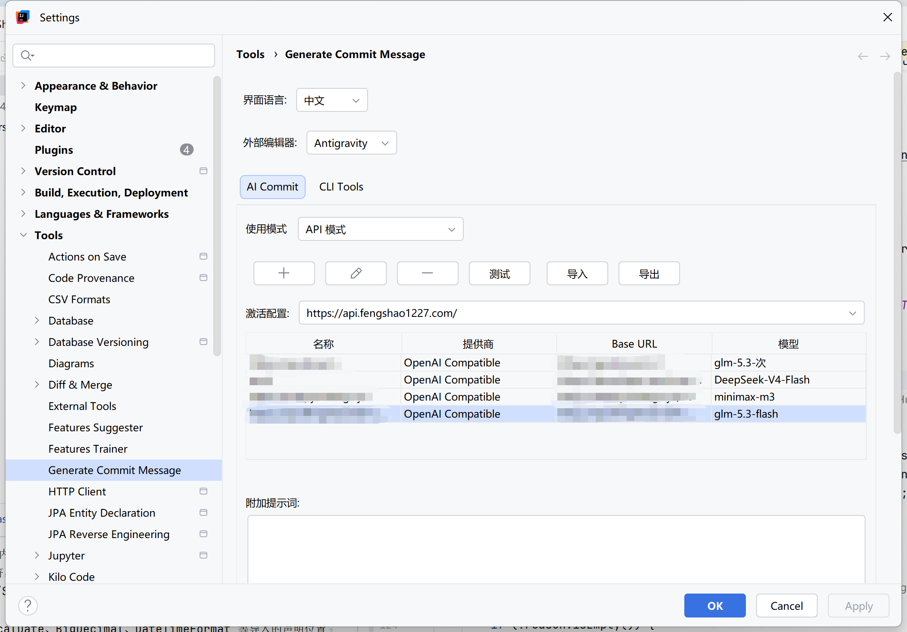
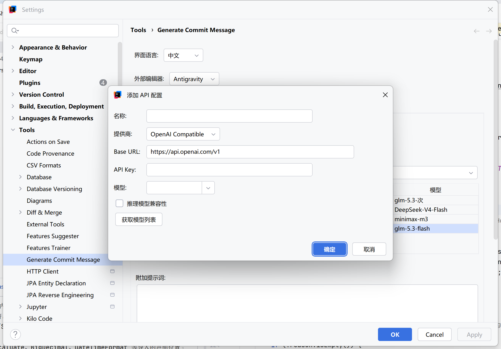
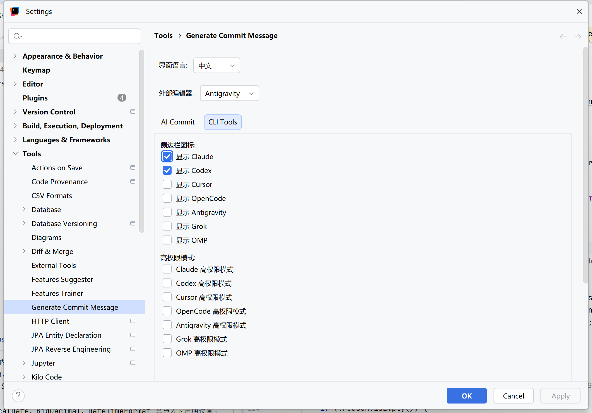
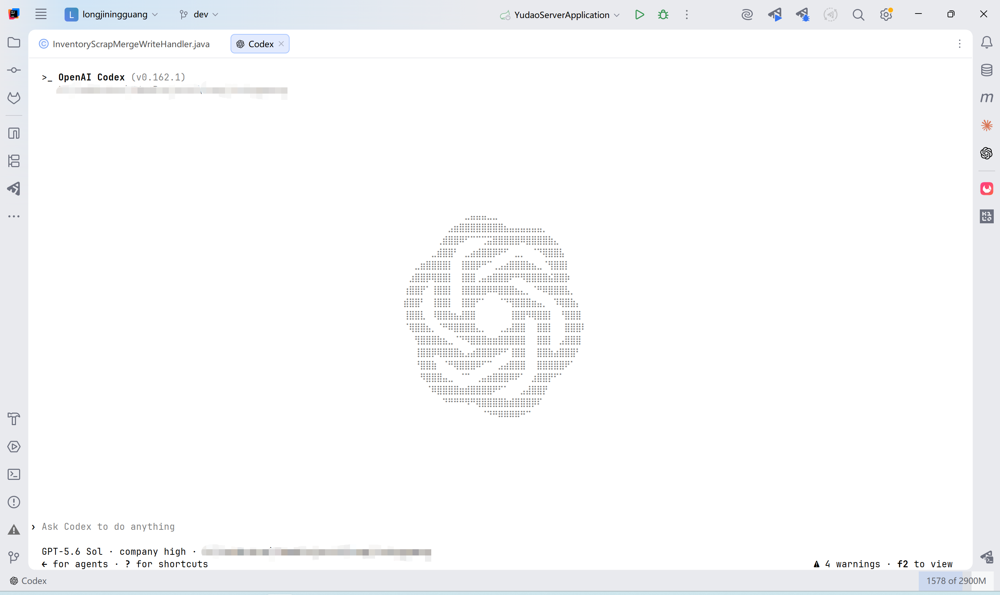
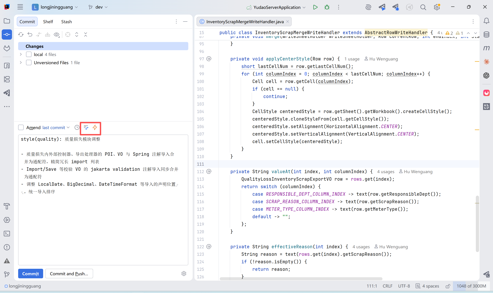
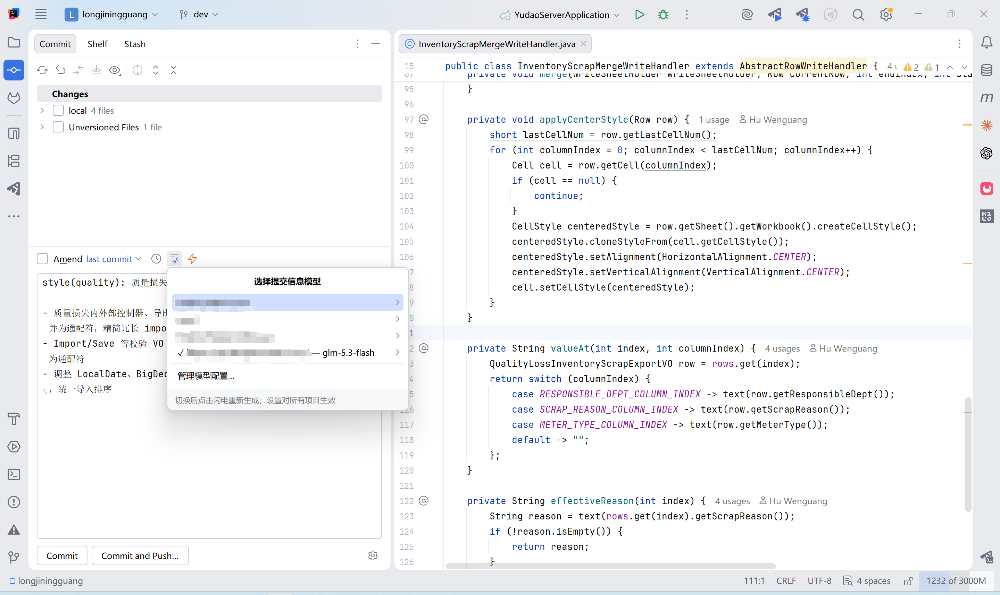

# Generate Commit Message

[简体中文](README_CN.md) | English

IntelliJ IDEA plugin based on [l-ning/cli-tools-idea](https://github.com/l-ning/cli-tools-idea), maintained by hwglhj.

## Features

- Generate a Git commit message from the changes selected in the commit panel, including untracked files.
- CLI mode: Claude, Codex, Cursor Agent, OpenCode, Gemini/agy, Grok, OMP and Pi. Reuse the CLI's authentication, select or type a model, and choose supported thinking levels. Pi (`pi`) and OMP (`omp`) are separate CLI tools and reuse their own configured providers and credentials.
- API mode: multiple OpenAI-compatible, Anthropic and custom OpenAI-compatible configurations. Each site persists its last successful model list; the commit-panel menu switches by site > model and can refresh one site without blocking the others. Add, edit, delete and activate configurations; fetch models or enter one manually; test a connection. API keys use IntelliJ PasswordSafe and are excluded from plugin XML settings.
- Export and import all API sites as versioned JSON. API keys are omitted by default; exporting them requires an explicit checkbox and confirmation. Same-ID imports overwrite site fields, while imports without a key preserve the local PasswordSafe key.
- Additional prompt, read-only built-in prompt, recent commit style reference (last 10), configurable diff limit (default 5000, minimum 500).
- Chinese/English interface and independent commit message language. Saving the interface language refreshes the settings page.
- Eight CLI terminal entries with individual visibility controls and high permission switches where the CLI supports one.
- Open the current file at its cursor position in VS Code, Cursor, Antigravity or Windsurf.
- Windows executable and npm launcher detection, npm/nvm PATH support, cancellation and process timeouts.
- A quick model switcher beside the commit-panel lightning action. The API menu opens immediately from the saved cache; each site has its own refresh action, and a successful refresh replaces the visible list without closing the popup. The active site is marked with a check and its current model. After a generation failure, selecting a model in the failure popup immediately retries the original selection using the new configuration.

AI Inline and REST API Search are not part of this plugin.

## What's new in 1.0.2

- A GitHub Releases update repository lets IDEA identify the plugin's update source and find newer versions.
- Selecting another API or CLI model after a generation failure immediately retries the original request.
- The release workflow checks IDEA 2026.1.5, 2026.2, 2026.2.4 and 2026.3 with JetBrains Plugin Verifier before publishing the ZIP and update manifest.

## Screenshots

### Manage multiple API sites and models

Use API mode to add, edit, remove, test, refresh, import and export multiple service configurations. Refresh applies only to the selected site and preserves its previous model cache on failure. The active configuration and its current model are stored independently, while API keys remain in IntelliJ PasswordSafe.



### Add an API configuration

Configure an OpenAI-compatible, Anthropic or custom endpoint with its Base URL and API key. Models can be entered manually or fetched from the service, and reasoning-model compatibility can be enabled when required.



### Configure CLI sidebar tools

Choose which CLI icons appear in the IDE sidebar and enable each tool's own high-permission startup option where supported. Pi runs with the current process permissions and therefore has no separate high-permission switch.



### Open a CLI in an editor terminal tab

Click a configured sidebar icon to open Claude, Codex, Cursor, OpenCode, Antigravity, Grok, OMP or Pi inside an IDE editor tab. Each click can create an independent terminal session in the current project.



### Generate a commit message

Select changes in the Commit tool window and click the lightning action. The plugin sends only the selected changes, applies the configured prompt and language, then writes the generated Conventional Commit message into the commit field.



### Switch sites and models from the Commit tool window

The model-list action beside the lightning button opens a grouped site/model menu immediately from the saved cache. The active site is marked with a check, models can be switched without opening Settings, and each site can be refreshed independently without closing the popup. If generation fails, selecting a model in the failure popup immediately retries using that site and model; no second click on the lightning button is needed. This works in API and CLI modes. Closing the popup leaves the request stopped. Opening the switcher from the toolbar only changes the model setting.



## Setup

Requires IntelliJ IDEA 2022.2 or later and the bundled Terminal plugin. The build targets platform 222 and Java 17. Releases are gated on JetBrains binary compatibility checks for **IDEA 2026.1.5, 2026.2, 2026.2.4 and 2026.3**; see the [version matrix and update channel](docs/IDE_COMPATIBILITY.md).

Download `generateCommitMessage-1.0.2.zip` from [GitHub Releases](https://github.com/hwglhj/generateCommitMessage/releases/latest) and install it using Settings > Plugins > Install Plugin from Disk, then restart the IDE. Configure Settings > Tools > Generate Commit Message, which contains **AI Commit** and **CLI Tools** tabs.

For updates, add `https://github.com/hwglhj/generateCommitMessage/releases/latest/download/updatePlugins.xml` under Settings > Plugins > ⚙️ > Manage Plugin Repositories. If IDEA displays “Unable to identify where Generate Commit Message was installed from”, select this repository in the plugin's update-source selector, then check for updates. See the [installation guide](INSTALL_GUIDE.md#插件更新来源).

CLI mode requires a separately installed and authenticated CLI. The optional executable path applies to the selected AI Commit CLI. Model candidates may include a public catalog or built-in fallback; the Test button verifies the selected model against the configured CLI. API mode does not require a local CLI. Custom APIs must implement the OpenAI chat-completions protocol; this is not universal provider support. Providers without `/models` can use a manually entered model. The API settings toolbar includes Windows-compatible JSON import/export controls.

High permission options pass each supported CLI's own approval flags. Pi inherits the current process permissions and therefore has no separate high permission switch. These options do not launch Windows as Administrator. API keys follow the IDE's PasswordSafe storage policy, including memory-only mode when configured in the IDE.

## Build On Windows

Use JDK 17 and Gradle 7.4.2 already installed on this machine:

```powershell
& 'D:\gradle-7.4.2\bin\gradle.bat' test verifyPlugin generateUpdatePluginsXml --no-daemon
```

The artifacts are `build/distributions/generateCommitMessage-1.0.2.zip` and `build/distributions/updatePlugins.xml`. The release workflow publishes both files after tests and version compatibility checks pass. No Git write operations are needed for a local build. Test temporary files use `tmp/tests/`.

See [installation and acceptance](INSTALL_GUIDE.md), [feature map](FEATURE_SUMMARY.md), [verification record](FINAL_SUMMARY.md), and [document index](DOCS_INDEX.md). Build and automated test results do not establish live provider availability or compatibility with every CLI version.

## License

See [LICENSE](LICENSE) and the original project's attribution.
