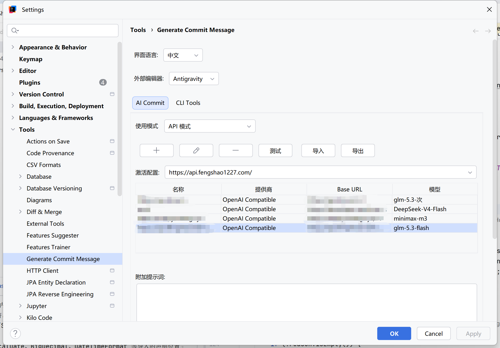
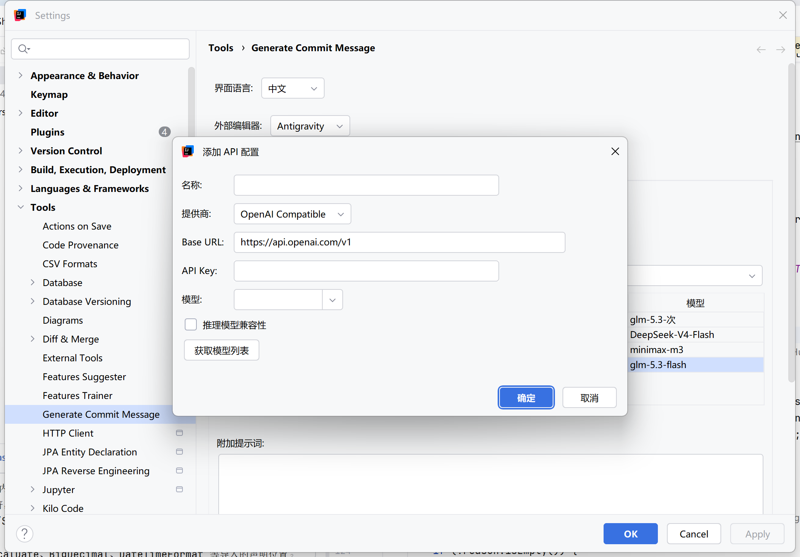
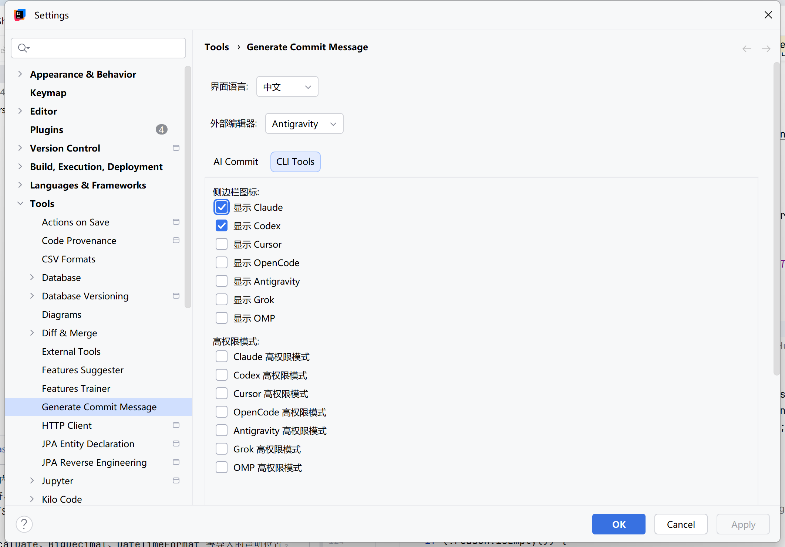
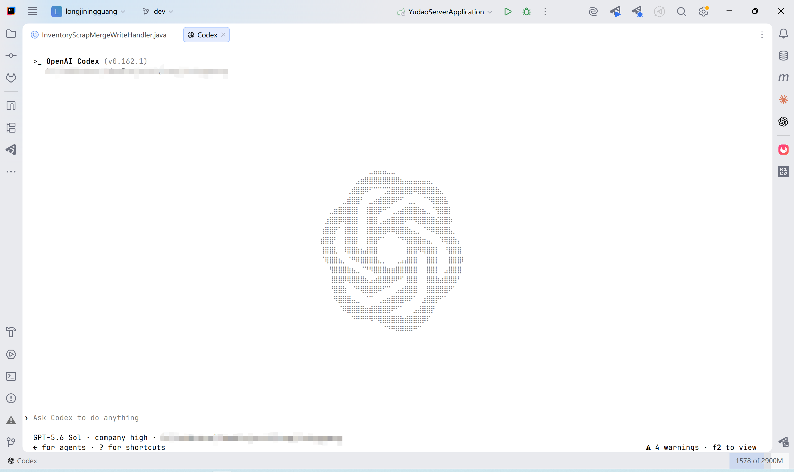
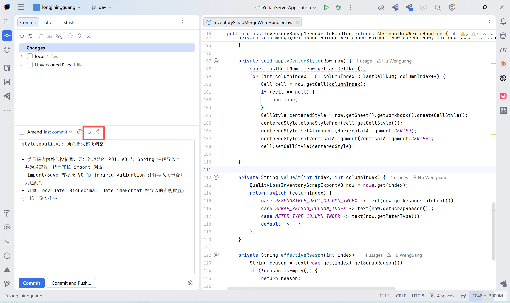
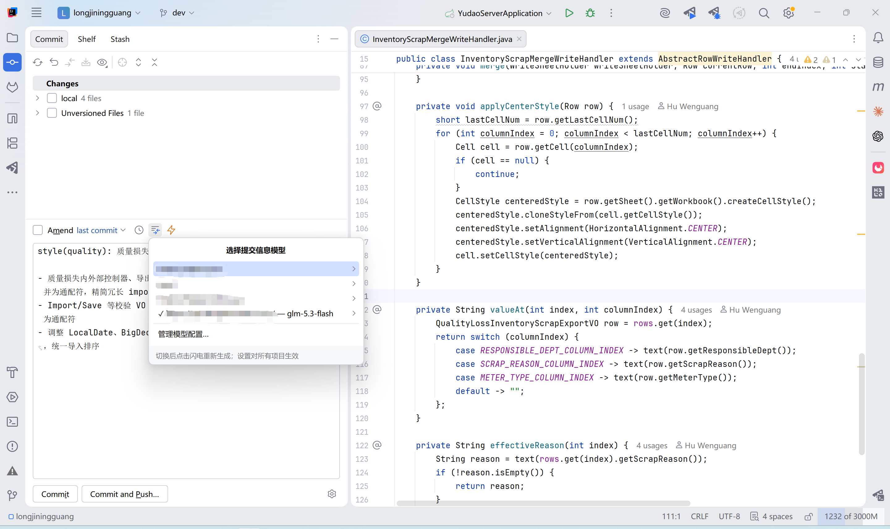

# Generate Commit Message

简体中文 | [English](README.md)

基于 [l-ning/cli-tools-idea](https://github.com/l-ning/cli-tools-idea) 的 IntelliJ IDEA 插件，维护者 hwglhj。

## 功能

- 根据提交面板勾选的变更生成提交信息，包括未跟踪文件；未勾选变更时不会发送全部文件。
- CLI 模式保留 Claude、Codex、Cursor Agent、OpenCode、Gemini/agy、Grok、OMP、Pi，复用各 CLI 登录，支持模型输入、搜索、刷新、思考等级和测试。Pi（`pi`）与 OMP（`omp`）是两个独立 CLI，分别复用各自配置的模型提供方和凭证。
- API 模式支持多个 OpenAI Compatible、Anthropic 和自定义配置，提供添加、编辑、删除、激活、模型获取和连接测试。每个站点可以保存多个模型，提交面板菜单按“站点 > 模型”快速切换；自定义提供商采用 OpenAI chat-completions 协议。
- API Key 使用 IntelliJ PasswordSafe 保存，不写入插件的 XML 配置；存储期限遵循 IDE 的密码设置，包括仅内存模式。
- API 站点支持 JSON 导入和导出。导出默认不包含 API Key，可勾选并确认后导出明文密钥；导入同 ID 站点会覆盖配置，没有密钥的导入会保留本机 PasswordSafe 密钥。
- 附加提示词、只读内置提示词、清空附加提示词、最近 10 条提交风格参考、Diff 长度限制（默认 5000 字符，最小 500）。
- 界面默认中文，可切换英文并在保存后刷新；提交信息输出语言独立设置。
- 右侧保留 8 个 CLI 终端入口，每个工具独立控制图标；仅对支持额外权限参数的 CLI 显示高权限启动开关。
- 外部编辑器可选 VS Code、Cursor、Antigravity、Windsurf，打开当前文件并携带光标行列。
- Windows 支持原生程序与 npm 启动器、npm/nvm 环境路径、生成取消和进程超时。
- 提交面板闪电按钮旁提供快速切换模型；打开 API 菜单会后台重新请求每个站点的完整模型列表，一级菜单用勾选和“站点 — 当前模型”标记当前激活站点；生成失败时自动打开同一模型列表，切换后再次点击闪电即可重试。

AI Inline 和 REST API Search 已从最终范围移除。

## 界面预览

### 管理多个 API 站点和模型

API 模式可以添加、编辑、删除、测试、导入和导出多个服务配置。每个站点独立保存当前模型，激活配置可直接切换；API Key 仍保存在 IntelliJ PasswordSafe 中。



### 添加 API 配置

支持配置 OpenAI Compatible、Anthropic 或自定义服务，填写 Base URL 和 API Key 后，可以手动输入模型，也可以从服务获取模型列表；需要时还可启用推理模型兼容模式。



### 配置 CLI 侧边栏工具

可以独立控制各 CLI 图标是否显示，并为支持额外权限参数的工具开启高权限启动。Pi 默认继承当前进程权限，因此没有单独的高权限开关。



### 在编辑器标签中打开 CLI 终端

点击右侧栏图标，可以把 Claude、Codex、Cursor、OpenCode、Antigravity、Grok、OMP 或 Pi 打开在 IDE 编辑器标签中。每次点击都可以在当前项目中新建独立终端会话。



### 生成提交信息

在 Commit 工具窗口勾选需要提交的变更，然后点击闪电按钮。插件只分析已选择的变更，应用当前提示词和输出语言，并把生成的 Conventional Commit 信息写入提交框。



### 在提交窗口快速切换站点和模型

闪电按钮旁的模型列表按钮会打开按站点分组的模型菜单。当前站点带有勾选标记，无需进入设置即可切换模型；生成失败时也会自动打开同一选择器，方便切换后重试。



## 安装与配置

最低 IntelliJ IDEA 2022.2，需启用 IDE 自带 Terminal 插件。编译基线为平台 222、Java 17；更新的 IDE 版本仍需安装验证。

从 `build/distributions/generateCommitMessage-1.0.0.zip` 安装：设置 > 插件 > 从磁盘安装插件，安装后重启 IDE。

配置入口为 **设置 > 工具 > Generate Commit Message**，仅有 **AI Commit** 和 **CLI Tools** 两个标签页。页面上方设置界面语言和外部编辑器。

CLI 模式需要先在本机安装并登录对应 CLI。可执行文件路径留空自动检测，手动路径用于当前 AI Commit CLI。模型列表可能包含公开目录和内置候选，真实可用性以“测试”结果为准。Pi 的模型列表来自本机 `pi --list-models`。高权限开关传递 CLI 自身的权限参数，不代表 Windows 管理员提权；Pi 默认继承当前进程权限，因此不显示单独的高权限开关。

API 模式不要求本机安装 CLI。填写 Base URL、API Key、模型，选中激活配置后保存；提供商没有 `/models` 接口时可直接手填模型，当前模型和候选模型都会保存。设置页站点操作行提供导入和导出，文件选择兼容 Windows 路径和中文文件名。自定义模式仅适用于兼容 chat-completions 的服务。

## Windows 构建

使用本机已有 JDK 17 和 Gradle 7.4.2：

```powershell
& 'D:\gradle-7.4.2\bin\gradle.bat' test --no-daemon
& 'D:\gradle-7.4.2\bin\gradle.bat' buildPlugin --no-daemon
```

产物在 `build/distributions/`，测试临时文件在 `tmp/tests/`。本地构建不需要暂存、提交或推送 Git。

详见[安装与验收](INSTALL_GUIDE.md)、[功能映射](FEATURE_SUMMARY.md)、[验证记录](FINAL_SUMMARY.md)和[文档索引](DOCS_INDEX.md)。自动化测试与打包通过不等于所有真实 API、CLI 版本和 IDE 版本均已实测。
